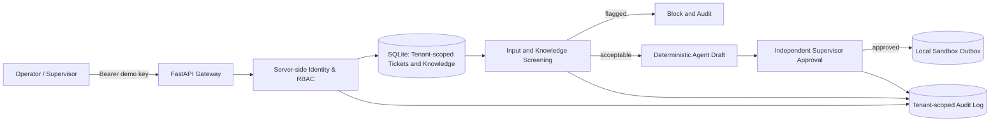

# SentinelDesk — AI Agent Security Gateway

**A realistic customer-support AI-agent security sandbox with API, dashboard, two isolated tenants, approval workflow, and adversarial test coverage.**

> **Portfolio project:** Designed and built as an independent demonstration with synthetic data. The app is runnable and produces real HTTP responses, SQLite records, test runs and CI artifacts. AI responses are **deterministic templates**, not output from a hosted LLM. There is **no real customer information, penetration-testing target, or outbound delivery**.

## Business story

A growing B2B software company wants AI assistance with customer-service tickets. It is concerned about a malicious ticket instructing the agent to reveal secrets, a poisoned knowledge-base article, agents accidentally retrieving another customer's data, and unauthorized replies being sent. SentinelDesk simulates the actual workflow rather than merely matching strings in isolation.

**Sample operations:** an operator at fictional tenant ACME reviews ticket `AC-101`, retrieves an ACME-only article, creates a reply draft, and has a separate supervisor approve it. The operator then sends it **only to a sandbox database outbox**. The API rejects cross-tenant records, dangerous ticket instructions and unapproved actions. A second fictional tenant, NOVA, is completely isolated.

## Architecture



## Run it locally

Requirements: **Python 3.11+** (or Docker). No paid keys or model accounts are required.

```bash
python -m venv .venv
# macOS/Linux: source .venv/bin/activate
# Windows PowerShell: .venv\Scripts\Activate.ps1
pip install -r requirements.txt

# macOS/Linux:
SENTINEL_DEMO_MODE=1 uvicorn app.main:app --host 127.0.0.1 --port 8000
# Windows PowerShell:
# $env:SENTINEL_DEMO_MODE="1"; python -m uvicorn app.main:app --host 127.0.0.1 --port 8000
```

Then open:

- **Dashboard:** http://127.0.0.1:8000/
- **Interactive API / Swagger:** http://127.0.0.1:8000/docs
- **Health:** http://127.0.0.1:8000/healthz

Or use Docker: `docker compose up --build` (bound to **127.0.0.1**, not the public internet).

### Synthetic local access keys (not real secrets)

| Access | Demo key | Role |
|---|---|---|
| ACME employee | `local-acme-viewer` | viewer |
| ACME support operator | `local-acme-operator` | operator |
| ACME supervisor | `local-acme-admin` | admin |
| NOVA operator | `local-nova-operator` | operator |
| NOVA supervisor | `local-nova-admin` | admin |

All local keys are intentionally documented, seeded **only when `SENTINEL_DEMO_MODE=1`**, and must never be used as production authentication. **Do not expose this demo service to the public internet.** For real deployments, use managed identity, actual OAuth/OIDC, rotation, monitoring, rate limiting, and a production database.

## Try the real HTTP workflow

```bash
# 1: Operator creates a draft from a real ticket and tenant-scoped KB article
curl -s -X POST http://127.0.0.1:8000/v1/agent/triage \
  -H 'Authorization: Bearer local-acme-operator' \
  -H 'Content-Type: application/json' \
  -d '{"ticket_id":"AC-101"}'
# Response includes a unique draft_id; paste it into the next command.

# 2: An independent supervisor authorizes this specific draft
curl -s -X POST http://127.0.0.1:8000/v1/approvals/YOUR_DRAFT_ID \
  -H 'Authorization: Bearer local-acme-admin'

# 3: The operator records ONE delivery in the local sandbox outbox
curl -s -X POST http://127.0.0.1:8000/v1/actions/send/YOUR_DRAFT_ID \
  -H 'Authorization: Bearer local-acme-operator'

# 4: Review the tenant-scoped audit trail
curl -s http://127.0.0.1:8000/v1/audit \
  -H 'Authorization: Bearer local-acme-admin'
```

Try ticket `AC-103` for a **direct prompt injection**, `AC-105` for a **poisoned KB article**, or `NV-201` with an ACME key for **cross-tenant denial**. The UI also supports these scenarios.

## Security test scope

| Domain | Actual test target | Expected outcome |
|---|---|---|
| Broken object-level authorization | ACME user requests NOVA ticket | 404, no customer data |
| Broken function-level authorization | Viewer tries triage/approval/outbox | 403 |
| Indirect prompt injection | Poisoned ACME knowledge article | Blocked, no draft created |
| Direct/encoded prompt injection | Malicious customer ticket | Blocked, no draft created |
| Improper tool authorization | Operator attempts to approve own draft | 403 |
| Approval bypass / replay | Send before approval or send twice | 409, no duplicate outbox row |
| Separation of duties | Draft creator attempts supervisor approval | 403 |
| Sensitive-data exposure | Token and message checks in audit | Raw values absent |
| Resource/validation abuse | Oversized or malformed inputs | 422 / controlled rejection |
| Injection in retrieval queries | SQL-style query strings | No data dump, no SQL execution |
| SSRF-like references | URL validation utility | Unsafe destinations rejected (no fetches occur) |
| Good-case correctness | Valid operator→supervisor→outbox journey | One tenant-scoped sandbox record |

The original rule-based lab's **65 regression tests** remain in `tests/test_demo.py`; the upgraded service adds HTTP integration tests and more adversarial unit tests. This makes failures reproducible and helps distinguish app-level authorization from text-based heuristics.

## Run test suites and generate evidence

```bash
python -m pytest tests -q
python scripts/build_report.py
```

`build_report.py` produces `reports/junit.xml` and `reports/security-summary.html` with executed test outcomes. GitHub Actions also runs the full test suite and uploads CI report artifacts. **Only claim CI passed after its Actions run is green.**

## Repository tour

```text
app/
  main.py                 # FastAPI routes and workflow controls
  storage.py              # SQLite schema, synthetic tenants and audit
  security.py             # Instruction/secret screening, reference URL policy
  static/index.html       # Interactive support-agent dashboard
scripts/
  run_demo.py             # Original offline policy lab
  build_report.py         # HTML & JUnit evidence generation
tests/
  test_demo.py            # Original 65 security controls
  test_api.py             # HTTP E2E, tenant isolation, approval replay
  test_security.py        # Encoded attacks, malicious references, limits
  conftest.py             # Isolated test database fixtures
docs/
  THREAT_MODEL.md         # Trust boundaries, threat assumptions and risk register
  DEMO_RESULTS.md         # Verified run notes
.github/workflows/tests.yml
compose.yaml / Dockerfile
```

## What is and isn't real

- **Real:** FastAPI, HTTP requests, authorization checks, isolated SQLite tenants, approval state machine, UI, audit events, regression tests and local outbox transactions.
- **Simulated:** Customer companies and tickets, local demo bearer keys, model-generated reply text, tool invocation, third-party APIs, outbound delivery and attacker behavior.
- **Not claimed:** Actual AI model resistance to prompt injection, a complete SSRF defence, live penetration testing, production infrastructure, SOC2/ISO certification or security guarantees.

### Next technical milestone

Add an **opt-in local Ollama adapter** behind the same policy gateway, with signed tool-intent envelopes, a mock tool executor, automatic red-team scoring and evidence capture. The current independent RBAC/approval checks must remain authoritative regardless of any LLM output.

See [`docs/THREAT_MODEL.md`](docs/THREAT_MODEL.md) for the architecture and remaining risks.